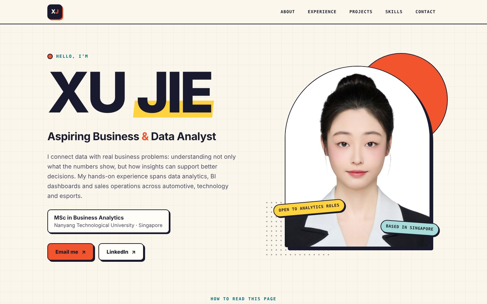
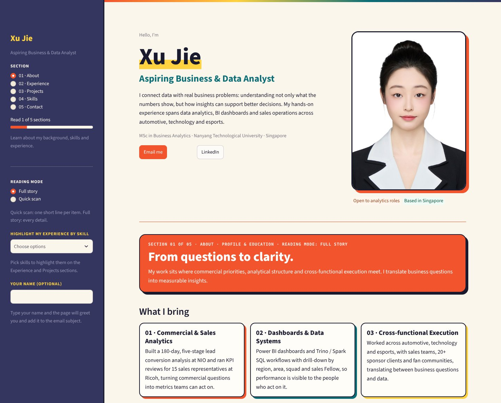
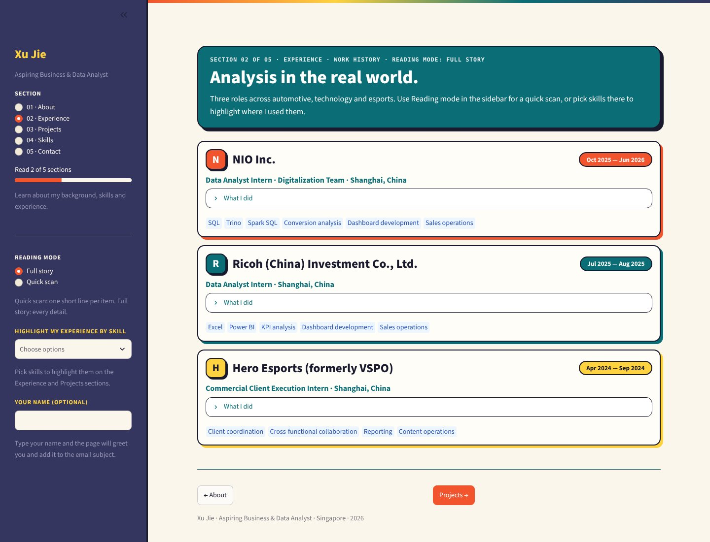
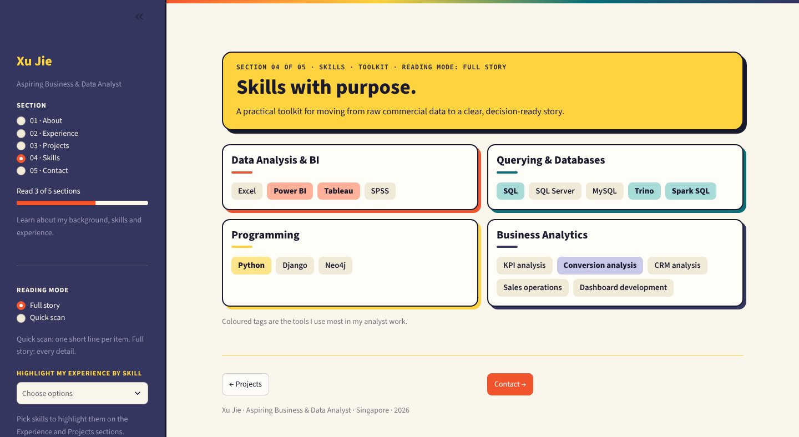
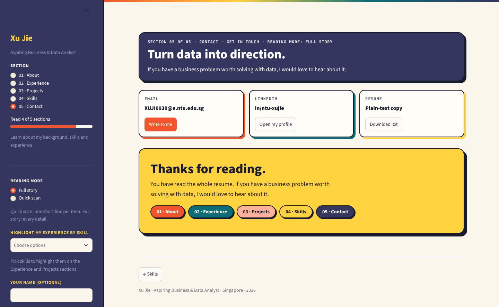

<div align="center">

# Xu Jie · Interactive Resume

**Aspiring Business & Data Analyst · MSc Business Analytics, Nanyang Technological University**

[](https://github.com/chagou313/xujie-resume/actions/workflows/tests.yml)


English | [简体中文](README.zh-CN.md)

### 🌐 [View the live resume →](https://chagou313.github.io/xujie-resume/)



</div>

## About this project

This is my resume, built as two interactive web pages instead of a static PDF:

| Version | File | What it is |
| --- | --- | --- |
| **Static website** | `index.html` | A single-file, dependency-free page (HTML + CSS only). Hosted on GitHub Pages, so it opens instantly on any device. |
| **Streamlit app** | `resume_app.py` | An interactive version written in Python, with reading modes, a skill filter and a personalised greeting. |

Both versions present the same content: my education, three internships (NIO, Ricoh, Hero Esports), selected projects, and an analytics toolkit covering SQL, Trino, Spark SQL, Python, Power BI and Tableau.

The project began as Part 1 of the **AN6100 Programming Essentials** course at NTU (2026).

## Features of the Streamlit app

- **Guided sections.** Five sections (About, Experience, Projects, Skills, Contact) with Previous/Next buttons and a reading-progress bar that tracks which sections a visitor has opened.
- **Two reading modes.** *Full story* shows every detail; *Quick scan* turns each role and project into a one-line summary for a 30-second read.
- **Skill filter.** A recruiter can pick skills (for example `SQL` or `Power BI`); matching roles and projects are highlighted and the rest are listed separately.
- **Personalised greeting.** A visitor can type their name. The page greets them and adds the name to the email subject. The input is sanitised before it is shown or placed in a link.
- **Plain-text download.** A `.txt` copy of the resume is generated from the same data as the page, so the two never go out of sync.
- **Data-driven layout.** All content lives in one `default_resume()` dictionary, so updating the resume means editing data, not layout code.
- **Custom visual design.** Neo-brutalist styling with colour-coded section bands, offset-shadow cards and CSS animations that respect `prefers-reduced-motion`.

## Screenshots

<table>
  <tr>
    <td width="50%"><b>About</b><br></td>
    <td width="50%"><b>Experience</b><br></td>
  </tr>
  <tr>
    <td width="50%"><b>Skills</b><br></td>
    <td width="50%"><b>Contact</b><br></td>
  </tr>
</table>

## Run it locally

**Static website:** open `index.html` in any browser.

**Streamlit app** (Python 3.10+):

```bash
git clone https://github.com/chagou313/xujie-resume.git
cd xujie-resume
python3 -m pip install -r requirements.txt
python3 -m streamlit run resume_app.py
```

The app opens at http://localhost:8501. Run it from the project folder so the theme in `.streamlit/config.toml` is applied.

**Tests:**

```bash
python3 -m pip install pytest
python3 -m pytest -v
```

## Project structure

```
xujie-resume/
├── index.html                  # Static resume website (served by GitHub Pages)
├── resume_app.py               # Interactive Streamlit version
├── assets/profile.jpeg         # Profile photo used by both versions
├── tests/test_resume_app.py    # Unit tests for helpers and resume data
├── docs/screenshots/           # Images used in this README
├── .streamlit/config.toml      # Streamlit theme
├── .github/workflows/tests.yml # CI: runs the tests on every push
└── requirements.txt
```

## Contact

- Email: [XUJI0030@e.ntu.edu.sg](mailto:XUJI0030@e.ntu.edu.sg)
- LinkedIn: [linkedin.com/in/ntu-xujie](https://www.linkedin.com/in/ntu-xujie)

## License

The code is released under the [MIT License](LICENSE). The resume content and profile photo are © Xu Jie and are not covered by the license.
