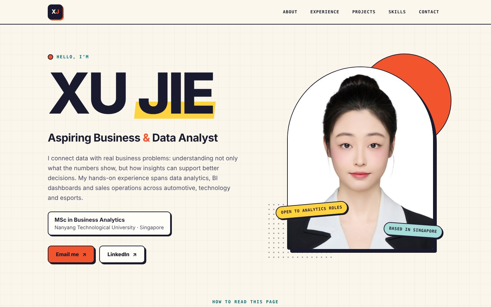
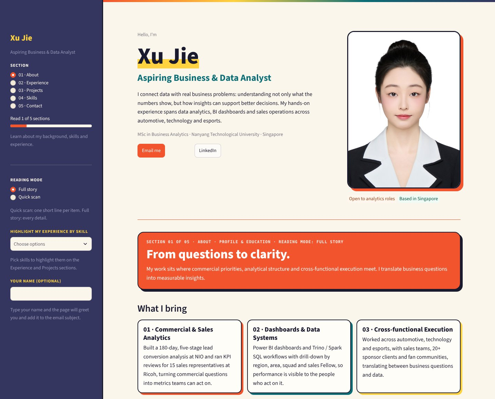
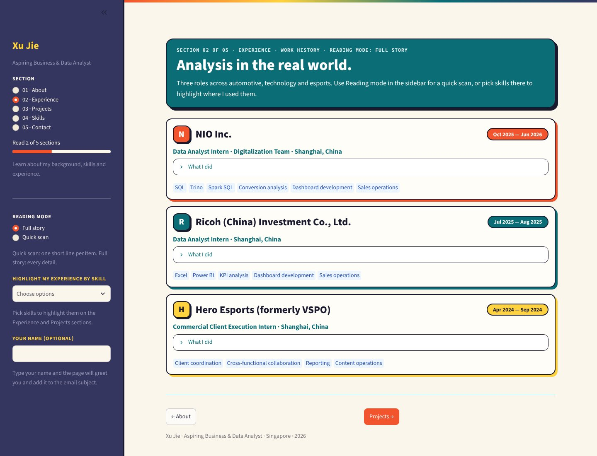
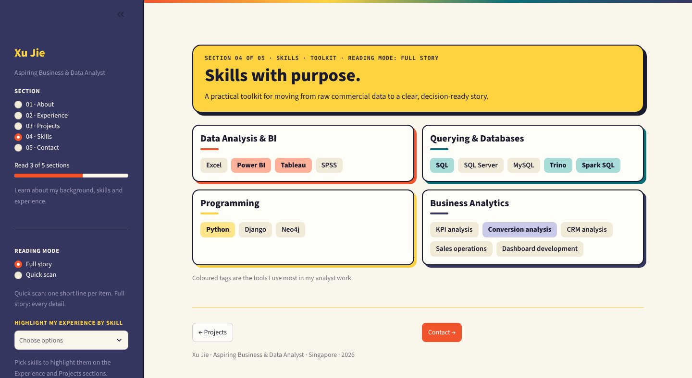
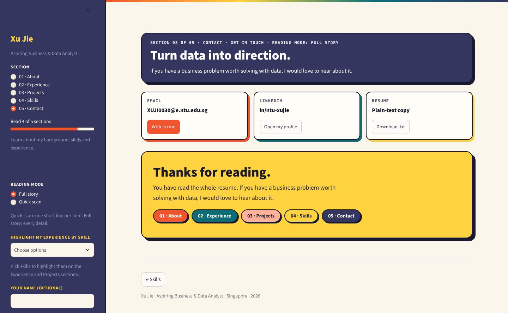

<div align="center">

# Xu Jie · 交互式简历

**商业与数据分析方向 · 南洋理工大学商业分析硕士**

[](https://github.com/chagou313/xujie-resume/actions/workflows/tests.yml)


[English](README.md) | 简体中文

### 🌐 [在线查看简历 →](https://chagou313.github.io/xujie-resume/)



</div>

## 项目简介

这是我的个人简历。我没有做成一份静态 PDF，而是做成了两个可交互的网页：

| 版本 | 文件 | 说明 |
| --- | --- | --- |
| **静态网站** | `index.html` | 单文件网页，只用 HTML 和 CSS，没有任何依赖。托管在 GitHub Pages 上，任何设备都能直接打开。 |
| **Streamlit 应用** | `resume_app.py` | 用 Python 编写的交互版本，支持阅读模式切换、技能筛选和个性化问候。 |

两个版本的内容相同，包括教育背景、三段实习经历（蔚来、理光、英雄电竞）、项目经历，以及涵盖 SQL、Trino、Spark SQL、Python、Power BI、Tableau 的分析技能。

本项目最初是南洋理工大学 **AN6100 Programming Essentials** 课程（2026）的第一部分作业。

## Streamlit 版功能

- **分章节浏览**：分为关于我、经历、项目、技能、联系方式五个章节，带上一页/下一页按钮，以及记录访客已读章节的阅读进度条。
- **两种阅读模式**："Full story" 显示全部细节；"Quick scan" 把每段经历和项目压缩成一句话，30 秒就能看完。
- **技能筛选**：招聘者可以选择技能（如 `SQL`、`Power BI`），匹配的经历和项目会被高亮，其余的单独列出。
- **个性化问候**：访客输入名字后，页面会打招呼，并把名字加入邮件主题。输入内容会先做过滤，才显示在页面或放进链接里。
- **纯文本下载**：可下载 `.txt` 版简历，它和网页由同一份数据生成，两者始终保持一致。
- **数据驱动的布局**：所有内容都集中在 `default_resume()` 字典里，更新简历只需改数据，不用改布局代码。
- **自定义视觉设计**：新粗野主义（neo-brutalist）风格，章节色带、偏移阴影卡片，以及会尊重 `prefers-reduced-motion` 设置的 CSS 动画。

## 截图

<table>
  <tr>
    <td width="50%"><b>关于我</b><br></td>
    <td width="50%"><b>经历</b><br></td>
  </tr>
  <tr>
    <td width="50%"><b>技能</b><br></td>
    <td width="50%"><b>联系方式</b><br></td>
  </tr>
</table>

## 本地运行

**静态网站**：用任意浏览器打开 `index.html` 即可。

**Streamlit 应用**（需要 Python 3.10 及以上）：

```bash
git clone https://github.com/chagou313/xujie-resume.git
cd xujie-resume
python3 -m pip install -r requirements.txt
python3 -m streamlit run resume_app.py
```

浏览器会打开 http://localhost:8501。请在项目文件夹内运行，这样才会应用 `.streamlit/config.toml` 里的主题。

**运行测试**：

```bash
python3 -m pip install pytest
python3 -m pytest -v
```

## 项目结构

```
xujie-resume/
├── index.html                  # 静态简历网站（由 GitHub Pages 托管）
├── resume_app.py               # Streamlit 交互版
├── assets/profile.jpeg         # 两个版本共用的头像
├── tests/test_resume_app.py    # 辅助函数和简历数据的单元测试
├── docs/screenshots/           # README 中使用的截图
├── .streamlit/config.toml      # Streamlit 主题
├── .github/workflows/tests.yml # CI：每次推送自动运行测试
└── requirements.txt
```

## 联系方式

- 邮箱：[XUJI0030@e.ntu.edu.sg](mailto:XUJI0030@e.ntu.edu.sg)
- LinkedIn：[linkedin.com/in/ntu-xujie](https://www.linkedin.com/in/ntu-xujie)

## 许可证

代码以 [MIT 许可证](LICENSE) 发布。简历内容和头像版权归Xu Jie所有，不在许可证范围内。
